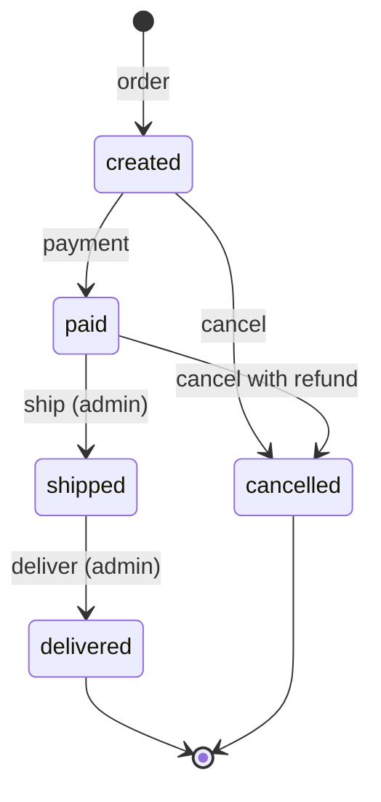

# Shop API

[](https://github.com/A160LKN/shop-api/actions/workflows/ci.yml)

[Русский](README.md) · **English**

An online shop backend with a complete test pyramid: unit tests, integration tests on real PostgreSQL, API tests, a mocked external payment gateway, a smoke test of the Docker image and a k6 load test in CI.

**Live:** [API docs](https://shop-api-yka7.onrender.com/docs) · [the shop built on this API](https://shop-web-azure.vercel.app). The free server sleeps when idle, so the first request can take up to a minute.

The project shows how to test a backend as a whole — business logic, the database, permissions, integration with an external service, concurrent requests and behaviour under load.

## What the API does

**The frontend for this API** is a React and TypeScript storefront and admin panel: [shop-web](https://github.com/A160LKN/shop-web). Together they form a fullstack application.

- **Sign-up and sign-in** — JWT, "customer" and "administrator" roles.
- **Catalogue** — search, categories, sorting (newest, by price, by name), an "in stock only" filter and a price range, pagination; the admin creates, edits and hides products.
- **Orders** — stock is reserved when the order is placed; the price is fixed and does not follow later catalogue changes. `POST /orders/quote` calculates the discounted total by the same rules in advance, without reserving stock or consuming the promo code. Orders can be filtered by status.
- **Promo codes** — percentage discount, minimum order amount, expiry date, usage limit.
- **Payment** through an external payment gateway, with a refund when a paid order is cancelled.
- **Admin dashboard** (`GET /stats`) — revenue, average order value, daily revenue for the week in the shop's time zone, orders by status, best sellers, low stock.
- **Order statuses** — a finite state machine:



## Stack

**App:** Python 3.13, FastAPI, SQLAlchemy 2, PostgreSQL 17, Alembic, Pydantic, JWT
**Tests:** pytest, respx (HTTP mocking), pytest-cov, Allure, k6, ruff
**Infrastructure:** Docker, Docker Compose, GitHub Actions

## Test pyramid — 243 tests

| Level       | Tests        | What they check                                                                                     | Speed         |
| ----------- | ------------ | --------------------------------------------------------------------------------------------------- | ------------- |
| Unit        | 59           | totals and discounts, all 20 "status × action" pairs, passwords and tokens, settings                | 0.3 s, no DB  |
| Integration | 7            | concurrent orders, transaction atomicity, DB constraints, migrations                                | on PostgreSQL |
| API         | 177          | whole endpoints: validation, permissions, business rules, payments via the gateway mock, edge cases | on PostgreSQL |
| Smoke       | 8 checks     | the built Docker image: order, promo code, payment, declined card                                   | in CI         |
| Load        | k6, 30 users | response time, errors, stock integrity after the load                                               | in CI         |

Code coverage is 100 %, but that is a consequence rather than a goal: the tests were written from requirements and risks, not for the number. CI fails if coverage drops below 90 %.

**Reports from the latest run on `main`:** [Allure — all tests by level](https://a160lkn.github.io/shop-api/) · [code coverage by file](https://a160lkn.github.io/shop-api/coverage/)

## The most interesting tests

### Concurrent orders: the last item is never sold twice

[`tests/integration/test_stock.py`](tests/integration/test_stock.py) — 20 customers order **at the same time** a product with 5 left in stock. Exactly 5 orders must succeed and the stock must end at 0.

The test is verified against the bug: remove the row lock (`SELECT … FOR UPDATE`) and all 20 orders go through, selling four times more than exists. Sequential tests and manual checks never show this bug — only concurrent load does. The promo code limit is tested the same way: 10 concurrent orders with a code limited to 3 uses.

A lock is not enough if the ORM reads something other than what is locked. BUG-09 showed this: the load test in CI found the stock off by 6 units. The order was loaded together with its products, and after `SELECT … FOR UPDATE` SQLAlchemy kept the stale stock value in the session, so a cancellation overwrote a sale that happened in parallel. The race is reproduced step by step in a deterministic test, and the test fails without the fix.

### Payment gateway — a mock instead of the real service

[`tests/api/test_payments.py`](tests/api/test_payments.py) — the gateway is replaced at the HTTP level (respx) while the application code runs as in production. This covers things a real service will not reproduce on demand:

- card declined → `402`, the order stays unpaid and can be paid with another card;
- timeout, dropped connection, `500` and `503` → `502` "no money was charged", the status does not change;
- paying twice → `409`, and **exactly one** request reached the gateway — no double charge;
- every gateway request carries an `Idempotency-Key`;
- a failed refund → the order stays paid and stock is not returned.

### Security

- **IDOR**: someone else's order by direct id returns `404`, like a missing one, so order numbers cannot be probed.
- **Roles cannot be forged**: a customer token with `"role": "admin"` grants nothing — the role comes from the database.
- **Bad tokens**: garbage, a foreign signature, expired, `alg: none`, a deleted user — all `401`.
- **Sign-in**: the same response for a wrong password and an unknown email, so registered users cannot be enumerated.
- **Search**: `%`, `_` and SQL injection in the search string neither break the query nor match everything.
- **Extra fields are rejected**: `"role": "admin"` at sign-up is a `422`, not silently ignored.
- **Brute force**: 5 failed logins in 15 minutes per email + IP give `429` with `Retry-After`; spoofing IPs does not help — a second limit allows 20 attempts per email from any address.
- **Weak passwords** (`12345678`, `password`, equal to the email) are rejected; sign-ups are limited to 10 per hour per IP.
- **Security headers** on every response: CSP, HSTS, X-Frame-Options, nosniff, Referrer-Policy.
- **No leaks in errors**: a 500 returns only a code and a request ID; bodies over 256 KB are rejected before parsing.
- **Automated in CI**: pip-audit, CodeQL and an OWASP ZAP scan of the running API. Policy: [SECURITY.md](SECURITY.md).

### Test design

- **Boundary values**: password length 7 / 8 / 128 / 129, discount 0 / 1 / 90 / 91 %, `limit` 0 / 1 / 100 / 101, promo minimum amount exactly and one tiyn below, expiry a second before and at the moment of expiry.
- **State transition table**: [all 20 "status × action" pairs](tests/unit/test_order_status.py), allowed and forbidden.
- **Equivalence classes**: invalid emails, amounts, quantities and tokens via parametrised tests.

### Load: 240 requests per second with no errors

[`loadtest/shop.js`](loadtest/shop.js) in k6 — guests browse the catalogue while customers order and pay concurrently. Thresholds on response time and errors, and after the load a reconciliation of stock against orders. Runs in CI on every push, with a report on the run page.

The stress test found two defects (BUG-07, BUG-08) and showed where the limit is. Before and after, at 225 concurrent users:

|                     | Before         | After   |
| ------------------- | -------------- | ------- |
| Requests per second | 52             | **240** |
| Errors              | 20 — all `500` | **0**   |
| Slowest response    | 30.3 s         | 3.0 s   |
| Catalogue, p95      | 251 ms         | 157 ms  |

The full report with causes, fixes and limitations (in Russian) — [docs/load-testing.md](docs/load-testing.md).

## Defects found

|        | What                                                                                                                                                            | How it was found                               | Status                                                               |
| ------ | --------------------------------------------------------------------------------------------------------------------------------------------------------------- | ---------------------------------------------- | -------------------------------------------------------------------- |
| BUG-01 | An email with surrounding spaces (`" AIBOL@Mail.KZ "`) failed format validation: spaces were trimmed **after** the check. Common when pasting an address.       | API test for case-insensitive email uniqueness | ✅ normalise before validating                                       |
| BUG-02 | A product over 21.5 million ₸ and an order for that amount — `500`: money was stored as INTEGER (max 2.1 billion tiyn) while the API allowed up to 1 billion ₸. | exploratory boundary testing                   | ✅ migration `0002`: money in BIGINT                                 |
| BUG-03 | An id above 2 147 483 647 in the URL or order body and a huge `offset` — `500` instead of `422`.                                                                | exploratory testing                            | ✅ limits in API schemas                                             |
| BUG-04 | A token with a valid signature but no `sub` or a non-numeric `sub` — `500` instead of `401`.                                                                    | exploratory testing                            | ✅ token fields validated                                            |
| BUG-05 | `PATCH /products/{id}` with `{"stock": null}` — a database `500` instead of `422`.                                                                              | exploratory testing                            | ✅ `null` forbidden in the schema                                    |
| BUG-06 | A promo code could be created with an end date in the past or without a time zone — unclear when it expires.                                                    | requirements review                            | ✅ future dates with a time zone only                                |
| BUG-07 | At ~200 users requests hung for 30 seconds and failed with `500`: fewer DB connections (15) than server threads (40).                                           | k6 load test                                   | ✅ pool sized to the server, `503` with `Retry-After` on overload    |
| BUG-08 | `GET /orders` returned every order at once — the response grew without bound.                                                                                   | k6 load test                                   | ✅ `limit` / `offset` pagination                                     |
| BUG-09 | Cancelling an order under load overwrote a parallel sale: stock drifted from orders (1 000 000 at start, 668 sold, 999 338 left — 6 too many).                  | integrity check in k6                          | ✅ `populate_existing` with row locks, deterministic regression test |

Every defect has a regression test, verified to fail on the old code.

## Running locally

Requires [Docker Desktop](https://www.docker.com/products/docker-desktop/).

```bash
docker compose up --build
```

- API: http://localhost:8000/docs
- Admin: `admin@shop.kz` / `admin12345`
- Promo codes: `WELCOME10` (10 %), `BIG20` (20 % from 100 000 ₸)
- Test cards: `tok_visa` — succeeds, `tok_declined` — declined, `tok_timeout` — gateway does not respond

Tests need PostgreSQL — the one from Docker Compose is easiest (the `shop_test` database is created automatically):

```bash
docker compose up -d db
pip install -r requirements-dev.txt
pytest                      # all tests
pytest -m unit              # unit only — no DB, a fraction of a second
pytest --cov                # with coverage
```

## CI

GitHub Actions on every push and pull request:

1. **Lint** — ruff.
2. **Tests** — unit without a DB, then integration and API tests on PostgreSQL in a service container; the Allure and coverage reports are published to GitHub Pages.
3. **Docker** — image build, app, DB and gateway via Docker Compose, a smoke test and a k6 load test with a report on the run page.
