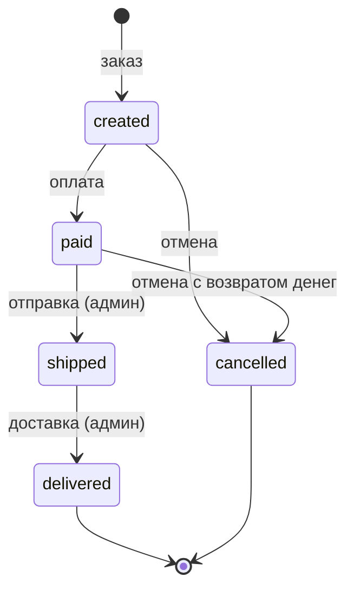

# Shop API

[](https://github.com/A160LKN/shop-api/actions/workflows/ci.yml)

Бэкенд интернет-магазина и полная пирамида тестов к нему: юнит-тесты, интеграционные тесты на настоящем PostgreSQL, API-тесты, мок внешнего платёжного шлюза, смоук-тест Docker-образа и нагрузочный тест на k6 в CI.

**Работает онлайн:** [документация API](https://shop-api-yka7.onrender.com/docs) · [магазин на этом API](https://shop-web-azure.vercel.app). Бесплатный сервер засыпает после простоя, поэтому первый запрос может идти до минуты.

Проект показывает, как тестировать бэкенд целиком — бизнес-логику, базу данных, права доступа, интеграцию с внешним сервисом, одновременные запросы и поведение под нагрузкой.

## Что умеет API

**Фронтенд к этому API** — витрина и админка на React и TypeScript: [shop-web](https://github.com/A160LKN/shop-web). Вместе — fullstack-приложение.

- **Регистрация и вход** — JWT-токен, роли «покупатель» и «администратор».
- **Каталог** — поиск, категории, сортировка (новые, по цене, по названию), фильтр «только в наличии» и диапазон цены, пагинация; администратор добавляет, меняет и скрывает товары.
- **Заказы** — товар резервируется на складе в момент заказа; цена фиксируется и не меняется вместе с каталогом. `POST /orders/quote` заранее считает итог со скидкой по тем же правилам, но ничего не резервирует и не расходует промокод. Список заказов фильтруется по статусу.
- **Промокоды** — процент скидки, минимальная сумма заказа, срок действия, лимит использований.
- **Оплата** через внешний платёжный шлюз, возврат денег при отмене оплаченного заказа.
- **Сводка для администратора** (`GET /stats`) — выручка, средний чек, выручка по дням за неделю в часовом поясе магазина, заказы по статусам, популярные товары, товары на исходе.
- **Статусы заказа** — конечный автомат:



Документация API с примерами — `http://localhost:8000/docs` после запуска.

## Стек

**Приложение:** Python 3.13, FastAPI, SQLAlchemy 2, PostgreSQL 17, Alembic, Pydantic, JWT
**Тесты:** pytest, respx (мок HTTP), pytest-cov, k6, ruff
**Инфраструктура:** Docker, Docker Compose, GitHub Actions

## Пирамида тестов — 227 тестов

| Уровень | Тестов | Что проверяют | Скорость |
| --- | --- | --- | --- |
| Юнит | 58 | расчёт суммы и скидки, все 20 пар «статус × действие», пароли и токены, настройки | 0,3 с, без БД |
| Интеграционные | 7 | одновременные заказы, атомарность транзакций, ограничения БД, миграции | на PostgreSQL |
| API | 162 | эндпоинты целиком: валидация, права доступа, бизнес-правила, оплата через мок шлюза, крайние случаи | на PostgreSQL |
| Смоук | 8 проверок | собранный Docker-образ: заказ, промокод, оплата, отказ банка | в CI |
| Нагрузка | k6, 30 пользователей | время ответа, ошибки, целостность склада после нагрузки | в CI |

Покрытие кода — 100 %, но это не цель, а следствие: тесты писались от требований и рисков, а не ради процента. CI падает, если покрытие опустится ниже 90 %.

## Самое интересное в тестах

### Одновременные заказы: последний товар не продаётся дважды

[`tests/integration/test_stock.py`](tests/integration/test_stock.py) — 20 покупателей **одновременно** заказывают товар, которого осталось 5 штук. Должно пройти ровно 5 заказов, остаток — 0.

Тест проверен на ошибку: если убрать из кода блокировку строк (`SELECT … FOR UPDATE`), все 20 заказов проходят, а склад «продаёт» в 4 раза больше, чем есть. В последовательных тестах и при ручной проверке такой баг не виден — только под одновременной нагрузкой. Так же проверяется лимит промокода: 10 одновременных заказов с промокодом на 3 использования.

Блокировки мало, если ORM читает не то, что заблокировано. Это показал BUG-09: нагрузочный тест в CI нашёл расхождение склада на 6 штук. Заказ загружался вместе с товарами, и после `SELECT … FOR UPDATE` SQLAlchemy оставлял в сессии старый остаток вместо свежего, поэтому отмена заказа затирала продажу, которая прошла параллельно. Гонка воспроизведена в тесте без случайностей, шаг за шагом, а тест проверен на ошибку: без исправления он падает.

### Платёжный шлюз — мок вместо настоящего сервиса

[`tests/api/test_payments.py`](tests/api/test_payments.py) — шлюз подменяется на уровне HTTP (respx), а код приложения работает как в продакшене. Так можно проверить то, что на реальном сервисе не воспроизвести по заказу:

- отказ банка → `402`, заказ остаётся неоплаченным, можно оплатить другой картой;
- таймаут, обрыв соединения, ответы `500` и `503` → `502` «деньги не списаны», статус не меняется;
- повторная оплата → `409`, в шлюз ушёл **ровно один** запрос — двойного списания нет;
- в каждом запросе к шлюзу есть `Idempotency-Key`;
- возврат не прошёл → заказ остаётся оплаченным, товар не возвращается на склад.

### Безопасность

- **IDOR**: чужой заказ по прямому id отвечает `404`, как несуществующий, — нельзя узнать, что заказ с таким номером есть.
- **Роль нельзя подделать**: токен с `"role": "admin"` у покупателя не даёт прав администратора — роль берётся из БД.
- **Плохие токены**: мусор, чужая подпись, истёкший срок, `alg: none`, удалённый пользователь — всё `401`.
- **Вход**: одинаковый ответ для неверного пароля и несуществующего email — перебором не узнать, кто зарегистрирован.
- **Поиск**: `%`, `_` и SQL-инъекции в строке поиска не ломают запрос и не находят всё подряд.
- **Лишние поля запрещены**: `"role": "admin"` при регистрации — ошибка `422`, а не тихий игнор.

### Тест-дизайн

- **Граничные значения**: длина пароля 7 / 8 / 128 / 129, процент скидки 0 / 1 / 90 / 91, `limit` 0 / 1 / 100 / 101, минимальная сумма промокода — ровно и на 1 тиын меньше, срок действия — за секунду до и в момент окончания.
- **Таблица переходов**: [все 20 пар «статус × действие»](tests/unit/test_order_status.py) — разрешённые и запрещённые.
- **Классы эквивалентности**: неверные email, суммы, количества, токены — параметризованными тестами.

### Нагрузка: 240 запросов в секунду без ошибок

[`loadtest/shop.js`](loadtest/shop.js) на k6 — гости смотрят каталог, покупатели одновременно заказывают и оплачивают. Пороги по времени ответа и ошибкам, а после нагрузки — сверка склада с заказами. В CI на каждый push, отчёт — на странице запуска.

Стресс-тест нашёл два дефекта (BUG-07, BUG-08) и показал, где предел. Было и стало на 225 одновременных пользователях:

| | Было | Стало |
| --- | --- | --- |
| Запросов в секунду | 52 | **240** |
| Ошибок | 20 — все `500` | **0** |
| Самый долгий ответ | 30,3 с | 3,0 с |
| Каталог, 95 % ответов | 251 мс | 157 мс |

Полный отчёт с причинами, исправлениями и ограничениями — [docs/load-testing.md](docs/load-testing.md).

### Крайние случаи: сервер не должен отвечать 500

[`tests/api/test_edge_cases.py`](tests/api/test_edge_cases.py) — запросы, которые обычный пользователь не отправит, но которые обязательно придут: огромные id и суммы, `null` в обязательном поле, токен с верной подписью, но без нужных полей, дата без часового пояса. Ответ `500` на любой запрос клиента — это баг: клиент не понимает, что исправить, а в логах — ложная тревога.

### Миграции

Схема тестовой БД создаётся теми же миграциями Alembic, что и в продакшене. Отдельные тесты проверяют, что модели и миграции не разошлись и что все миграции можно откатить и применить заново. Исправление BUG-02 — пример изменения схемы через новую миграцию, а не правкой старой.

Тесты стирают базу целиком, поэтому запускаются только на базе с `test` в имени — рабочую базу по ошибке не тронут.

## Найденные дефекты

| | Что | Как нашёл | Статус |
| --- | --- | --- | --- |
| BUG-01 | Email с пробелами по краям (`" AIBOL@Mail.KZ "`) отклонялся с ошибкой формата: пробелы обрезались **после** проверки формата. Частый случай при копировании адреса. | API-тест на уникальность email без учёта регистра | ✅ нормализация до проверки |
| BUG-02 | Товар дороже 21,5 млн ₸ и заказ на такую сумму — `500`: деньги хранились в INTEGER (максимум 2,1 млрд тиынов), хотя API разрешал до 1 млрд ₸. | исследовательское тестирование граничных значений | ✅ миграция `0002`: деньги в BIGINT |
| BUG-03 | id больше 2 147 483 647 в адресе или в теле заказа и огромный `offset` — `500` вместо `422`. | исследовательское тестирование | ✅ ограничения в схемах API |
| BUG-04 | Токен с верной подписью, но без поля `sub` или с нечисловым `sub` — `500` вместо `401`. | исследовательское тестирование | ✅ проверка полей токена |
| BUG-05 | `PATCH /products/{id}` с `{"stock": null}` — `500` от базы данных вместо `422`. | исследовательское тестирование | ✅ `null` запрещён в схеме |
| BUG-06 | Промокод создавался с датой окончания в прошлом и с датой без часового пояса — непонятно, по какому времени он истекает. | ревью требований | ✅ только будущая дата с часовым поясом |
| BUG-07 | При ~200 пользователях запросы висели 30 секунд и падали с `500`: соединений с БД (15) меньше, чем потоков сервера (40). | нагрузочный тест k6 | ✅ пул по размеру сервера, при перегрузке — `503` с `Retry-After` |
| BUG-08 | `GET /orders` отдавал все заказы разом — ответ рос бесконечно. | нагрузочный тест k6 | ✅ пагинация `limit` / `offset` |
| BUG-09 | Отмена заказа под нагрузкой затирала параллельную продажу: склад расходился с заказами (было 1 000 000, продано 668, осталось 999 338 — на 6 больше). | проверка целостности в k6 | ✅ `populate_existing` при блокировке строк, детерминированный регрессионный тест |

Для каждого дефекта есть регрессионный тест; проверено, что на старом коде эти тесты падают.

## Деплой

Бесплатно: API на [Render](https://render.com) (Docker), база на [Neon](https://neon.tech). Бесплатная база Render удаляется через 30 дней, у Neon срока нет.

1. Neon: создать проект и скопировать адрес подключения (`postgresql://…`). Драйвер приложение подставит само.
2. Render: **New → Blueprint** → этот репозиторий. Настройки берутся из [`render.yaml`](render.yaml), вставить нужно только `DATABASE_URL` и `CORS_ORIGINS` (адрес фронтенда).
3. При старте [`scripts/start-render.sh`](scripts/start-render.sh) применяет миграции, загружает демо-данные и запускает учебный платёжный шлюз рядом с API.

Бесплатный сервер засыпает после 15 минут простоя, и первый запрос после этого идёт до минуты.

## Запуск

Нужен [Docker Desktop](https://www.docker.com/products/docker-desktop/).

```bash
docker compose up --build
```

- API: http://localhost:8000/docs
- Администратор: `admin@shop.kz` / `admin12345`
- Промокоды: `WELCOME10` (10 %), `BIG20` (20 % от 100 000 ₸)
- Тестовые карты: `tok_visa` — оплата проходит, `tok_declined` — отказ банка, `tok_timeout` — шлюз не отвечает
- Демо-каталог — 18 товаров в 4 категориях
- Фронтенду с другого адреса доступ открывается переменной `CORS_ORIGINS` (адреса через запятую; по умолчанию — локальный фронтенд на портах 5173 и 4173)

Смоук-тест и нагрузочный тест запущенного приложения (нужен [k6](https://grafana.com/docs/k6/latest/set-up/install-k6/)):

```bash
./scripts/smoke.sh
k6 run loadtest/shop.js                      # 30 пользователей, как в CI
k6 run -e PROFILE=stress loadtest/shop.js    # до 225 пользователей — поиск предела
```

## Запуск тестов

Тестам нужен PostgreSQL — проще всего тот же, что в Docker Compose (база `shop_test` создаётся автоматически):

```bash
docker compose up -d db

python3 -m venv .venv
source .venv/bin/activate
pip install -r requirements-dev.txt

pytest                      # все тесты
pytest -m unit              # только юнит — без БД, за доли секунды
pytest -m "integration or api"
pytest --cov                # с покрытием
```

## Структура

```
├── app
│   ├── domain              — чистая бизнес-логика без БД: расчёт суммы, статусы заказа
│   ├── services            — операции с заказами (транзакции, блокировки), клиент платёжного шлюза
│   ├── routers             — эндпоинты API
│   ├── models.py           — таблицы БД
│   ├── schemas.py          — схемы запросов и ответов
│   └── security.py         — пароли, JWT, проверка ролей
├── migrations              — миграции Alembic
├── tests
│   ├── unit                — без БД и сети
│   ├── integration         — на PostgreSQL: конкурентность, транзакции, миграции
│   └── api                 — HTTP-запросы к приложению, мок шлюза
├── loadtest/shop.js        — нагрузочный тест на k6
├── docs/load-testing.md    — отчёт о нагрузочном тестировании
├── tools/fake_gateway.py   — имитация платёжного шлюза для локального запуска
├── scripts/smoke.sh        — смоук-тест
├── Dockerfile
└── docker-compose.yml      — приложение, PostgreSQL, шлюз
```

## CI

GitHub Actions на каждый push и pull request:

1. **Линтер** — ruff.
2. **Тесты** — юнит без БД, затем интеграционные и API на PostgreSQL в сервис-контейнере; отчёт о покрытии сохраняется как артефакт.
3. **Docker** — сборка образа, запуск приложения, БД и шлюза через Docker Compose, смоук-тест и нагрузочный тест на k6 с отчётом на странице запуска.
