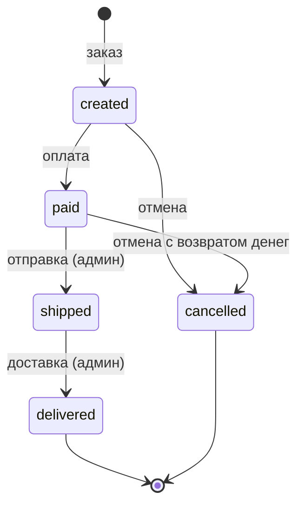

# Shop API

[](https://github.com/A160LKN/shop-api/actions/workflows/ci.yml)

Бэкенд интернет-магазина и полная пирамида тестов к нему: юнит-тесты, интеграционные тесты на настоящем PostgreSQL, API-тесты, мок внешнего платёжного шлюза и смоук-тест Docker-образа в CI.

Проект показывает, как тестировать бэкенд целиком — бизнес-логику, базу данных, права доступа, интеграцию с внешним сервисом и одновременные запросы.

## Что умеет API

- **Регистрация и вход** — JWT-токен, роли «покупатель» и «администратор».
- **Каталог** — поиск, фильтр по категории, пагинация; администратор добавляет, меняет и скрывает товары.
- **Заказы** — товар резервируется на складе в момент заказа; цена фиксируется и не меняется вместе с каталогом.
- **Промокоды** — процент скидки, минимальная сумма заказа, срок действия, лимит использований.
- **Оплата** через внешний платёжный шлюз, возврат денег при отмене оплаченного заказа.
- **Статусы заказа** — конечный автомат:



Документация API с примерами — `http://localhost:8000/docs` после запуска.

## Стек

**Приложение:** Python 3.13, FastAPI, SQLAlchemy 2, PostgreSQL 17, Alembic, Pydantic, JWT
**Тесты:** pytest, respx (мок HTTP), pytest-cov, ruff
**Инфраструктура:** Docker, Docker Compose, GitHub Actions

## Пирамида тестов — 163 теста

| Уровень | Тестов | Что проверяют | Скорость |
| --- | --- | --- | --- |
| Юнит | 55 | расчёт суммы и скидки, все 20 пар «статус × действие», пароли и токены | 0,3 с, без БД |
| Интеграционные | 6 | одновременные заказы, атомарность транзакций, ограничения БД, миграции | на PostgreSQL |
| API | 102 | эндпоинты целиком: валидация, права доступа, бизнес-правила, оплата через мок шлюза | на PostgreSQL |
| Смоук | 8 проверок | собранный Docker-образ: заказ, промокод, оплата, отказ банка | в CI |

Покрытие кода — 100 %, но это не цель, а следствие: тесты писались от требований и рисков, а не ради процента. CI падает, если покрытие опустится ниже 90 %.

## Самое интересное в тестах

### Одновременные заказы: последний товар не продаётся дважды

[`tests/integration/test_stock.py`](tests/integration/test_stock.py) — 20 покупателей **одновременно** заказывают товар, которого осталось 5 штук. Должно пройти ровно 5 заказов, остаток — 0.

Тест проверен на ошибку: если убрать из кода блокировку строк (`SELECT … FOR UPDATE`), все 20 заказов проходят, а склад «продаёт» в 4 раза больше, чем есть. В последовательных тестах и при ручной проверке такой баг не виден — только под одновременной нагрузкой. Так же проверяется лимит промокода: 10 одновременных заказов с промокодом на 3 использования.

### Платёжный шлюз — мок вместо настоящего сервиса

[`tests/api/test_payments.py`](tests/api/test_payments.py) — шлюз подменяется на уровне HTTP (respx), а код приложения работает как в продакшене. Так можно проверить то, что на реальном сервисе не воспроизвести по заказу:

- отказ банка → `402`, заказ остаётся неоплаченным, можно оплатить другой картой;
- таймаут, обрыв соединения, ответы `500` и `503` → `502` «деньги не списаны», статус не меняется;
- повторная оплата → `409`, в шлюз ушёл **ровно один** запрос — двойного списания нет;
- в каждом запросе к шлюзу есть `Idempotency-Key`;
- возврат не прошёл → заказ остаётся оплаченным, товар не возвращается на склад.

### Безопасность

- **IDOR**: чужой заказ по прямому id отвечает `404`, как несуществующий, — нельзя узнать, что заказ с таким номером есть.
- **Роль нельзя подделать**: токен с `"role": "admin"` у покупателя не даёт прав администратора — роль берётся из БД.
- **Плохие токены**: мусор, чужая подпись, истёкший срок, `alg: none`, удалённый пользователь — всё `401`.
- **Вход**: одинаковый ответ для неверного пароля и несуществующего email — перебором не узнать, кто зарегистрирован.
- **Поиск**: `%`, `_` и SQL-инъекции в строке поиска не ломают запрос и не находят всё подряд.
- **Лишние поля запрещены**: `"role": "admin"` при регистрации — ошибка `422`, а не тихий игнор.

### Тест-дизайн

- **Граничные значения**: длина пароля 7 / 8 / 128 / 129, процент скидки 0 / 1 / 90 / 91, `limit` 0 / 1 / 100 / 101, минимальная сумма промокода — ровно и на 1 тиын меньше, срок действия — за секунду до и в момент окончания.
- **Таблица переходов**: [все 20 пар «статус × действие»](tests/unit/test_order_status.py) — разрешённые и запрещённые.
- **Классы эквивалентности**: неверные email, суммы, количества, токены — параметризованными тестами.

### Миграции

Схема тестовой БД создаётся теми же миграциями Alembic, что и в продакшене. Отдельные тесты проверяют, что модели и миграции не разошлись и что миграцию можно откатить и применить заново.

## Найденные дефекты

| | Что | Как нашёл | Статус |
| --- | --- | --- | --- |
| BUG-01 | Email с пробелами по краям (`" AIBOL@Mail.KZ "`) отклонялся с ошибкой формата: пробелы обрезались **после** проверки формата. Частый случай при копировании адреса. | API-тест на уникальность email без учёта регистра | ✅ исправлен — нормализация до проверки |

## Запуск

Нужен [Docker Desktop](https://www.docker.com/products/docker-desktop/).

```bash
docker compose up --build
```

- API: http://localhost:8000/docs
- Администратор: `admin@shop.kz` / `admin12345`
- Промокоды: `WELCOME10` (10 %), `BIG20` (20 % от 100 000 ₸)
- Тестовые карты: `tok_visa` — оплата проходит, `tok_declined` — отказ банка, `tok_timeout` — шлюз не отвечает

Смоук-тест запущенного приложения:

```bash
./scripts/smoke.sh
```

## Запуск тестов

Тестам нужен PostgreSQL — проще всего тот же, что в Docker Compose (база `shop_test` создаётся автоматически):

```bash
docker compose up -d db

python3 -m venv .venv
source .venv/bin/activate
pip install -r requirements-dev.txt

pytest                      # все тесты
pytest -m unit              # только юнит — без БД, за доли секунды
pytest -m "integration or api"
pytest --cov                # с покрытием
```

## Структура

```
├── app
│   ├── domain              — чистая бизнес-логика без БД: расчёт суммы, статусы заказа
│   ├── services            — операции с заказами (транзакции, блокировки), клиент платёжного шлюза
│   ├── routers             — эндпоинты API
│   ├── models.py           — таблицы БД
│   ├── schemas.py          — схемы запросов и ответов
│   └── security.py         — пароли, JWT, проверка ролей
├── migrations              — миграции Alembic
├── tests
│   ├── unit                — без БД и сети
│   ├── integration         — на PostgreSQL: конкурентность, транзакции, миграции
│   └── api                 — HTTP-запросы к приложению, мок шлюза
├── tools/fake_gateway.py   — имитация платёжного шлюза для локального запуска
├── scripts/smoke.sh        — смоук-тест
├── Dockerfile
└── docker-compose.yml      — приложение, PostgreSQL, шлюз
```

## CI

GitHub Actions на каждый push и pull request:

1. **Линтер** — ruff.
2. **Тесты** — юнит без БД, затем интеграционные и API на PostgreSQL в сервис-контейнере; отчёт о покрытии сохраняется как артефакт.
3. **Docker** — сборка образа, запуск приложения, БД и шлюза через Docker Compose, смоук-тест.
